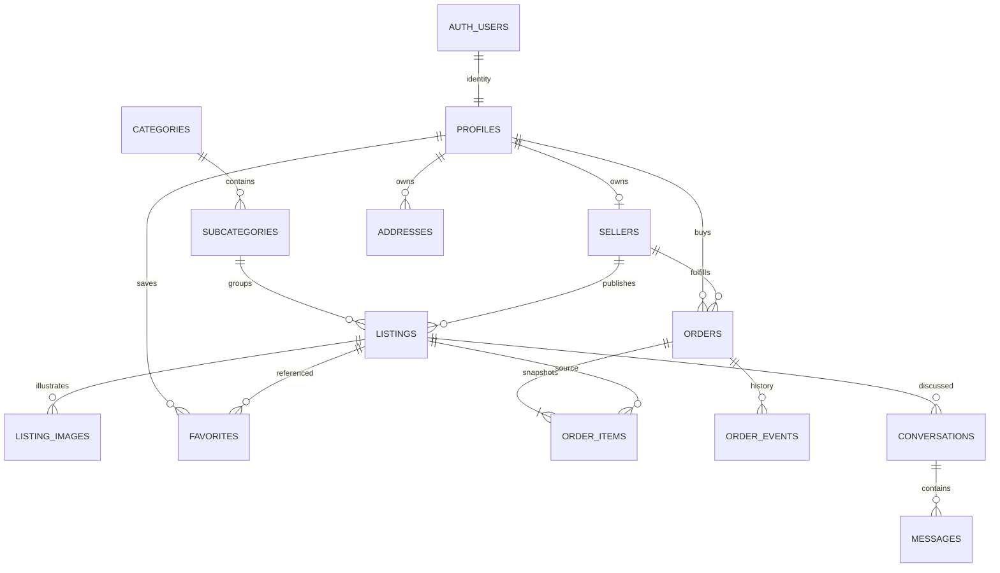

# Supabase ALLIN

## Дополнительная схема в общем проекте (16 ноября 2026)

По явному указанию пользователя в проекте `dhqesykaixefswhksiyu` (в панели называется Paletter02) создана отдельная схема `allin` и служебная `allin_private`. Панель: https://supabase.com/dashboard/project/dhqesykaixefswhksiyu/editor — выберите схему `allin`.

Созданы те же 13 предметных таблиц, описанные ниже, RLS, внешние ключи, индексы и функции `allin.place_order` / `allin.change_order_status`. Загружены 13 категорий и 162 подкатегории из существующей миграции справочника. Создан отдельный закрытый bucket `allin-listing-images`. Существующие таблицы, функции и политики других приложений не изменялись.

В общем проекте профиль создаётся явно через INSERT в `allin.profiles`: `id` должен совпадать с `auth.uid()`. Разрешены только `id`, `full_name`, `phone`, `avatar_path`. Общих триггеров на `auth.users` и копирования существующих пользователей нет. Создание своего профиля и запрет подмены владельца отдельно проверены `tests/allin-profile-access.sql` с откатом фикстур. Остальные правила доступа и заказов соответствуют описанию ниже.

SQL именно этого проекта хранится отдельно: `supabase/targets/dhqesykaixefswhksiyu/migrations/`. Эти файлы уже применены; не запускайте их повторно или поверх прежних миграций другого проекта. Исторические файлы `supabase/migrations/` относятся к исходной базе ALLIN, описанной ниже.

`tests/allin-schema-access.sql` выполнен на целевом проекте одной транзакцией с ROLLBACK: проверены приватность профилей/адресов/переписки, ограничения владельца, цена и количество заказа, идемпотентность, снимки цены и переходы статусов. Все проверки прошли, тестовые аккаунты и данные откатились. На всех 13 таблицах проверено наличие RLS. Security Advisor не сообщает замечаний по новым схемам; Performance Advisor отмечает пока не используемые индексы. Общие замечания проекта относятся к другим схемам и отключённой проверке скомпрометированных паролей; настройки других приложений не менялись.

Подключение приложения к этому проекту в эту задачу не входит: `.env.local`, клиент, типы и текущие доменные API не переключены. Для будущего подключения потребуется добавить `allin` в Exposed schemas Data API (не добавлять `allin_private`), использовать `supabase.schema('allin')`, создать профиль текущего пользователя и обновить типы из схемы `allin`. Общие настройки API не изменялись. См. [документацию пользовательских схем](https://supabase.com/docs/guides/api/using-custom-schemas).

`npm.cmd run lint` и `npm.cmd run typecheck` выполнены. Оба завершаются ошибками существующего прикладного кода: lint — 39 ошибок и 14 предупреждений (в том числе avatar, input-antd, use-countdown-timer и отсутствующий expo-image-picker); typecheck — несовместимые props текста, типы Reanimated, Colors, импорты WebP и отсутствующие модули. TypeScript/JSX и зависимости в этой задаче не изменялись.

## Исходный отдельный проект ALLIN

- Организация: Delivera (`wjefldgivtqbacngdehe`).
- Проект: ALLIN (`bykdrszypuzpdbxenziy`).
- Панель: https://supabase.com/dashboard/project/bykdrszypuzpdbxenziy
- Регион: Франкфурт (`eu-central-1`).
- Тариф при создании: Free, подтверждённая стоимость $0 в месяц.
- API: https://bykdrszypuzpdbxenziy.supabase.co

## Рабочая база

Созданы и применены миграции в `supabase/migrations/`. Имена и версии локальных файлов совпадают с историей проекта. В справочник перенесены 13 разделов и 162 подкатегории текущего приложения; демонстрационные продавцы и предложения в базу не копировались. ID подкатегории имеет вид `category-id/subcategory-id`, чтобы исходные короткие ID разных групп не конфликтовали.

| Таблицы | Назначение и доступ |
| --- | --- |
| `profiles` | Приватное имя и контактный телефон; строка автоматически создаётся для нового `auth.users`. Email и пароль принадлежат Supabase Auth. |
| `sellers` | Магазин/исполнитель с неизменяемым владельцем; опубликованный профиль доступен всем, неопубликованный — только владельцу. |
| `categories`, `subcategories` | Общедоступные справочники; клиент не может их менять. |
| `listings`, `listing_images` | Товар или услуга, три режима заказа, цена за единицу, черновик/публикация/архив; изменяет владелец магазина. |
| `favorites`, `addresses` | Личные данные пользователя; у адресов не более одного основного. |
| `orders`, `order_items`, `order_events` | Заказ, снимки названия/цены/количества и журнал статусов; читают покупатель и продавец. |
| `conversations`, `messages` | Обсуждение конкретного предложения; доступно только покупателю и владельцу магазина. |

На всех 13 прикладных таблицах включён RLS, права выданы отдельно и ограничены нужными колонками. Политики проверяют `auth.uid()` и владельца записи; `user_metadata` не предоставляет административных прав. Отображаемое имя из metadata используется только для первичного заполнения профиля.

`place_order` создаёт заказ на одно предложение с количеством 1–999. Покупатель определяется из сессии, цена читается из опубликованного предложения; режим `negotiation` не допускает прямую покупку. Сумма вычисляется в Postgres через `numeric`, название и цена копируются в `order_items`, адрес — в снимок заказа. Один `request_id` не создаёт дубликаты; повтор с другими параметрами отклоняется. Клиент хранит этот ID до выяснения результата запроса. Складские остатки, резервирование, стоимость доставки и оплата пока не реализованы.

`change_order_status` допускает подтверждение, выполнение и завершение только продавцом; покупатель и продавец могут отменить заказ до начала выполнения. Прямые INSERT/UPDATE заказов клиенту запрещены. Привилегированная реализация находится в неэкспонируемой схеме `private`, всегда проверяет текущего пользователя и вызывается через публичные функции `SECURITY INVOKER`. Доменные обёртки — `features/orders/api/purchase.api.ts`.

Создан закрытый bucket `listing-images` (JPEG, PNG, WebP, до 10 МБ). Пользователь пишет только в свой префикс `<auth.uid()>/…`; читать изображения опубликованных предложений можно через разрешённые записи `listing_images`. Для закрытого bucket нужен authenticated download или короткоживущий signed URL, а не `getPublicUrl`. Прежний `storage-upload.ts` относится к старой инфраструктуре и не подключён к этому сценарию.

## Авторизация и подключение

Локальный `.env.local` содержит URL и публичный publishable-ключ под именами, которые уже читает `shared/api/supabase/supabase.ts`. Файл исключён из Git. Для другого рабочего места скопируйте `.env.example` в `.env.local` и заполните значения из панели проекта. Не используйте secret/service_role-ключ в приложении.

После изменения `.env.local` полностью перезапустите Metro: `npm run dev -- --clear`, затем заново откройте приложение. Уже запущенный сервер может продолжать отдавать сборку без новых переменных. `EXPO_PUBLIC_SUPABASE_URL` и `EXPO_PUBLIC_SUPABASE_KEY` должны присутствовать в окружении сборки; файл `.env.example` сам по себе не загружается как конфигурация.

Клиент создаётся лениво через `getSupabaseClient()`, а не при импорте модуля маршрутом. Отсутствие URL или ключа не обрушает Expo Router: `useAuthStore.initialize()` переводит запуск в контролируемое состояние ошибки, `AppSession` показывает сообщение об отсутствии настройки. Обновление токена на native начинается только после успешного восстановления сессии. Импорт `react-native-url-polyfill/auto` до SDK обеспечивает полноценные URL в React Native: встроенная реализация не имеет setter для `protocol`, который использует конструктор Supabase 2.119.0. Полифилл не требует новой нативной сборки.

Установлен `@supabase/supabase-js` с закреплённой версией 2.119.0. Типы `shared/api/supabase/database.types.ts` сгенерированы из действующей базы. Единственный клиент находится в `shared/api/supabase/supabase.ts`; токены хранит SDK через SecureStore на native и localStorage в браузере. Неиспользуемая универсальная CRUD-фабрика удалена: запросы пишутся в доменных API, а заказ имеет отдельный RPC-контракт.

`features/auth/api/supabase-auth.api.ts` реализует регистрацию, вход и доступ к своему профилю. `useAuthStore` — единственная проекция серверной сессии для UI, без хранения пароля и токенов в Zustand. `AppSession` восстанавливает сессию до показа экранов, управляет обновлением токена при возвращении приложения и очищает кеши и локальные данные профиля при смене пользователя. Поздний ответ старой сессии не подменяет текущий аккаунт. Приватный профиль загружается до его редактирования; ошибку чтения можно повторить.

**Confirm email выключен в облачном проекте пользователем и проверен через Auth API и реальную регистрацию.** Новый аккаунт сразу получает сессию. Локальная конфигурация `supabase/config.toml` также содержит `[auth.email] enable_confirmations = false`; сама по себе она не меняет настройки облака. Регистрация сохраняет существующие три экрана: имя → почта → пароль. Редактор профиля сохраняет имя/телефон в базе; email пока доступен только для чтения.

Серверная сессия, регистрация, вход, выход и сохранение профиля подключены к UI. Каталог и экран заказов пока используют прежние демоданные; локальный черновик, адреса и избранное ещё не синхронизируются с новыми таблицами. Интерфейсы публикации в облако, переписки, оформления заказа и оплаты не объявляются реализованными наличием таблиц.

## Проверки

- `tests/supabase-access.sql` запускается одной транзакцией и откатывает фикстуры: проверяет RLS, прямой доступ, подмену владельца/отправителя, количество, цену, повтор заказа, снимки и переходы статусов.
- Security Advisor после миграций не выявил замечаний. Performance Advisor сообщает только о пока не использованных индексах новой базы: [описание проверки](https://supabase.com/docs/guides/database/database-linter?lint=0005_unused_index).
- Реальный Auth API проверен на временном аккаунте: регистрация без письма, создание профиля, запрет гостевого доступа, сохранение имени, неверный пароль, вход и выход.
- В браузере проверены три шага регистрации, восстановление после перезагрузки, изменение профиля, выход и повтор входа после ошибки. Временные аккаунты удаляются после проверки.
- `node tests/supabase-startup.test.cjs` проверяет безопасный импорт при отсутствии URL/ключа, обработку ошибки восстановления, реальную инициализацию SDK с URL React Native и полифиллом, единственный экземпляр клиента и сохранение URL браузера. Проверки не создают аккаунты и не выполняют запросы в базу.
- Проверка запуска в Chrome: с конфигурацией открываются гостевой профиль, вход и регистрация; при удалении URL из тестового браузерного бандла появляется состояние конфигурации, ошибок выполнения нет. Подключённого native-устройства нет, поэтому эта проверка не заменяет повторный запуск на устройстве после очистки Metro.
